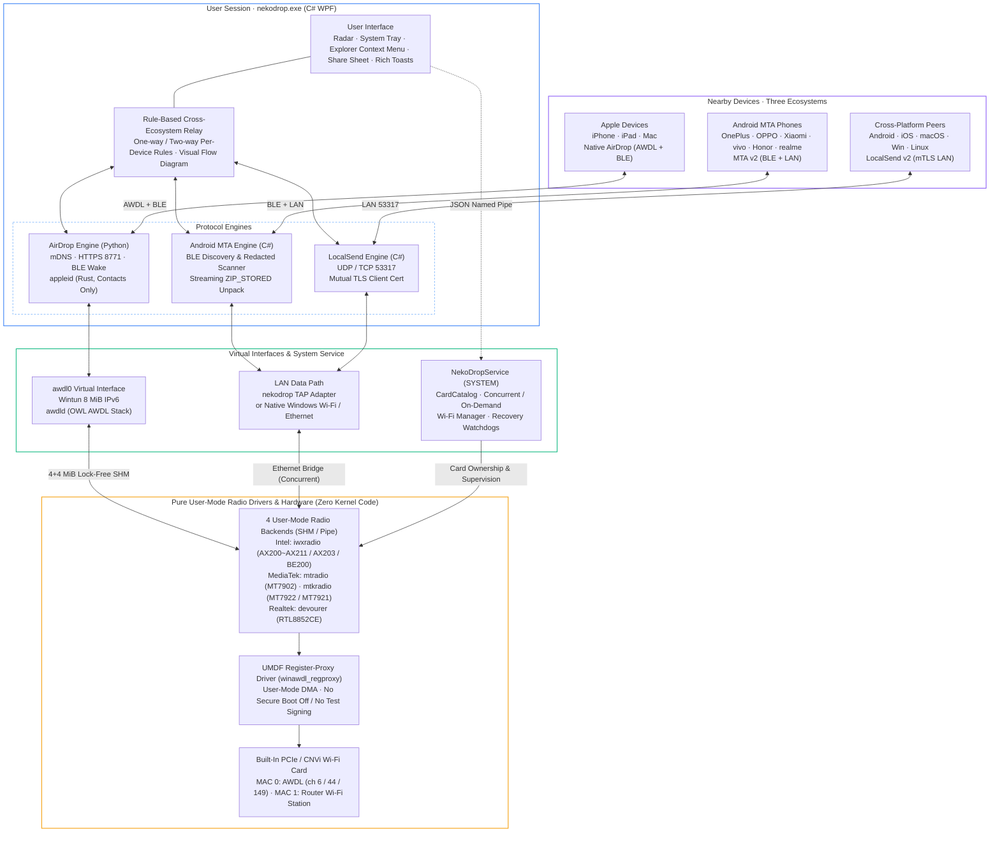

# Architecture Overview

English · [简体中文](ARCHITECTURE.zh-CN.md) · [Back to README](../README.en.md) · [How it works](HOW-IT-WORKS.md)

The diagram below shows all four layers of nekodrop on Windows: nearby devices across three ecosystems, the user-mode client and rule-based relay, the virtual interfaces and system service, and the four user-mode radio backends driving the built-in Wi-Fi hardware through a UMDF register proxy.

## Layer Summary

1. **Nearby Devices:** Connects to native Apple AirDrop, Android Mutual Transmission Alliance (MTA v2), and cross-platform LocalSend v2 peers under one unified radar and send window.
2. **User Session (`nekodrop.exe`):** Hosts the WPF UI, Explorer context menu, notifications, and the **rule-based cross-ecosystem relay**, coordinating the Python AirDrop engine (with Rust `appleid` for Contacts Only), the C# MTA v2 engine, and the C# LocalSend v2 engine.
3. **Virtual Interfaces & System Service:** `awdld` exposes `awdl0` (Wintun IPv6) for AirDrop; LAN traffic bridges through the `"nekodrop"` TAP adapter in Concurrent mode or uses native Windows Wi-Fi/Ethernet in On-Demand/wired setups; `NekoDropService` handles `CardCatalog` matching, mode switching, Wi-Fi management, and recovery watchdogs.
4. **User-Mode Radio Drivers & Hardware:** `winawdl_regproxy` (UMDF) maps PCIe/CNVi registers and interrupts into the user-mode radio process with zero custom kernel code, powering four user-mode backends across Intel, MediaTek, and Realtek cards.

For deeper internals, see [How it works](HOW-IT-WORKS.md), [Design notes](DESIGN.md), and [Client & service](CLIENT.md).
