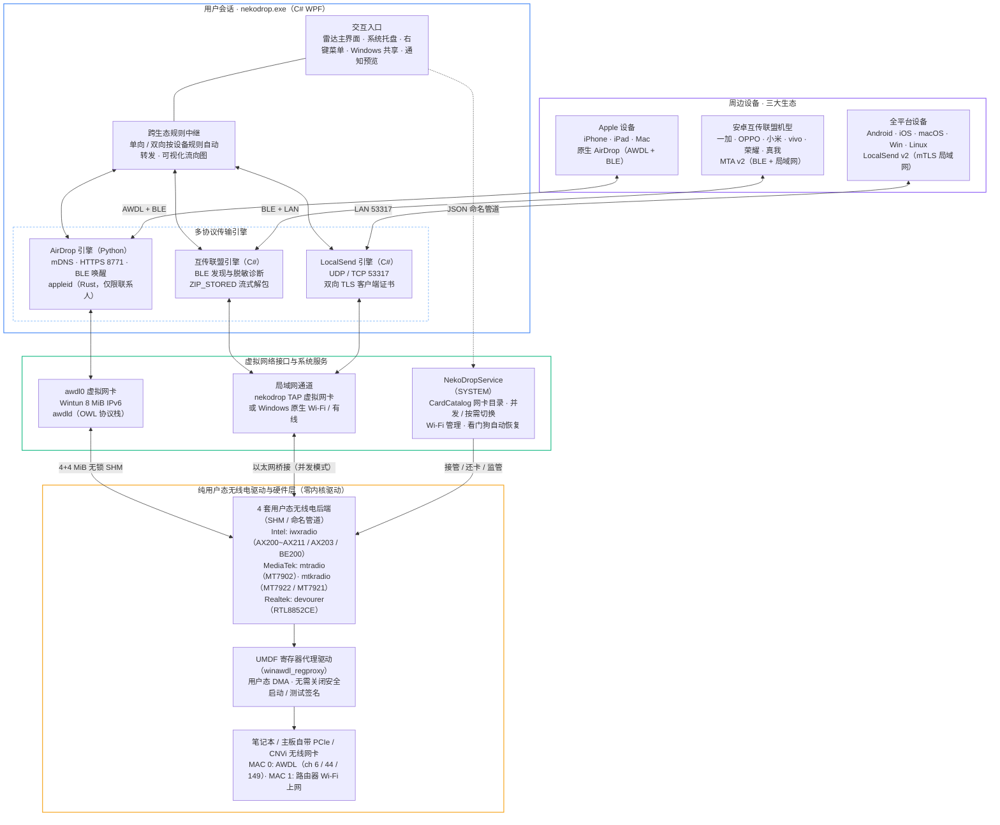

# 全景架构

[English](ARCHITECTURE.md) · 简体中文 · [返回 README](../README.md) · [工作原理](HOW-IT-WORKS.zh-CN.md)

下图展示了 nekodrop 在 Windows 上的完整四层结构：从周边三大生态设备、用户态客户端与跨生态规则中继，到虚拟网卡与系统服务，再到底层 4 套纯用户态无线电驱动和 UMDF 寄存器代理。

## 分层说明

1. **周边设备层**：同时面向 Apple 原生 AirDrop、安卓互传联盟（MTA v2）与跨平台 LocalSend v2，统一呈现在同一套雷达和发送窗口中。
2. **用户会话层（`nekodrop.exe`）**：负责雷达 UI、资源管理器右键、系统通知与**规则化跨生态中继**；内部调度 Python AirDrop 引擎（含 Rust `appleid` 证书工具）、C# MTA v2 引擎与 C# LocalSend v2 引擎。
3. **虚拟网络与系统服务层**：`awdld` 通过 Wintun 暴露 IPv6 接口 `awdl0` 跑 AirDrop；局域网流量在并发模式下经 `"nekodrop"` TAP 虚拟网卡桥接，在按需/有线模式下直接走 Windows 原生网卡；`NekoDropService` 负责 `CardCatalog` 网卡匹配、模式切换、Wi-Fi 站点管理与看门狗恢复。
4. **用户态驱动与硬件层**：`winawdl_regproxy`（UMDF）将 PCIe/CNVi 网卡寄存器与中断映射给用户态无线电进程，不运行任何自定义内核驱动，支持 Intel / MediaTek / Realtek 三大阵营 4 套用户态后端。

更多实现细节见 [工作原理](HOW-IT-WORKS.zh-CN.md)、[底层架构设计](DESIGN.md) 与 [客户端与服务说明](CLIENT.md)。
